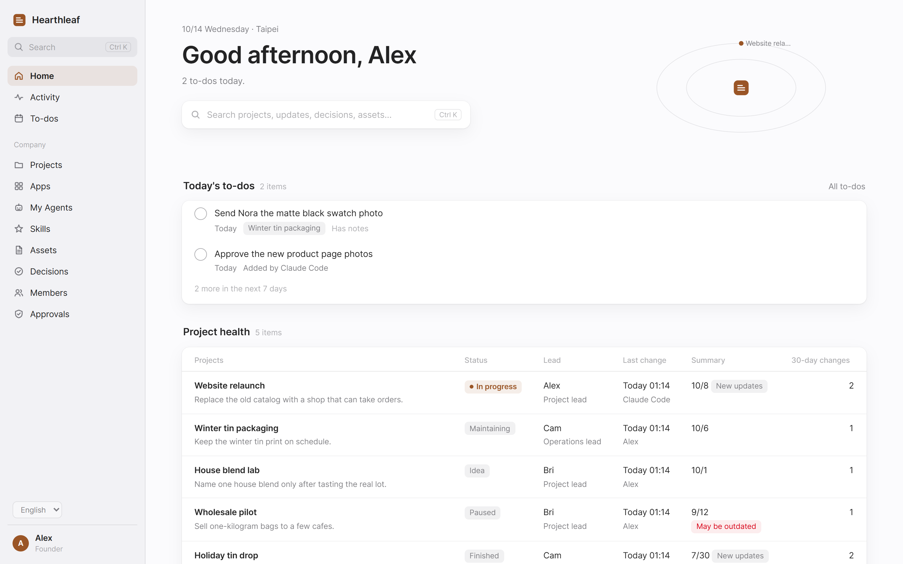
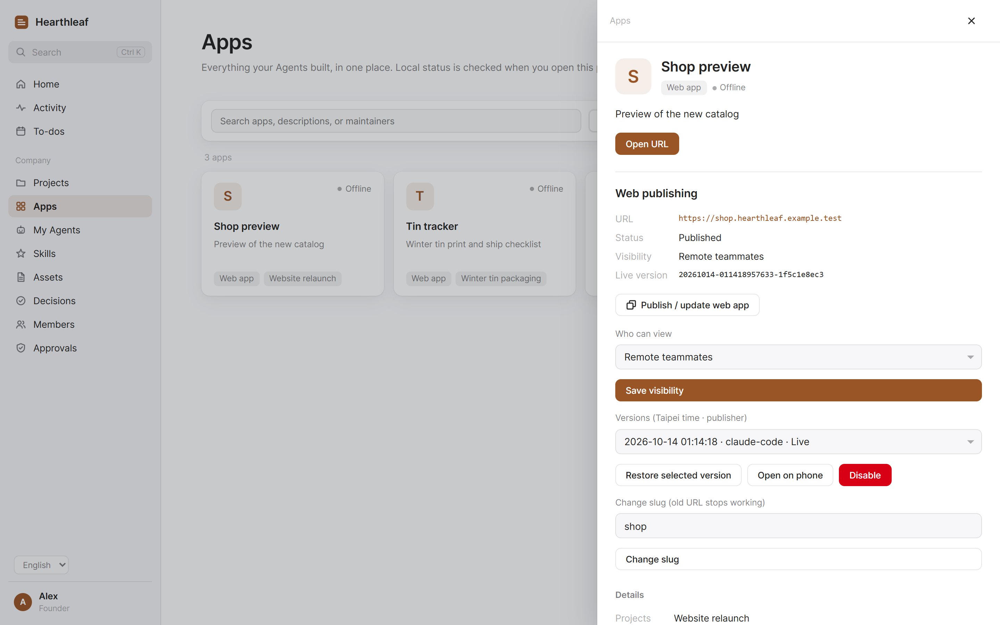
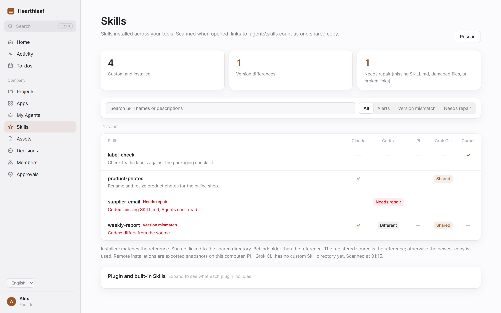

# Onestead

An AI back office for a small company, or a company of one.



## Why

Each new agent needs the same company briefing: what you do, which projects are active, who owns them, and what has been decided. Small apps and useful Skills also need a place where people can find them and get access.

Onestead puts those company facts in a git repository you own, gives agents MCP tools to work with them, and gives people a web app to read, approve, and manage access.

## What you can do

### Keep company facts in one place

Store the handbook, projects, decisions, assets, and members as Markdown. Agents can read and search them, add progress, update project summaries, and record decisions. Writes create git commits attributed to the member who made them. The owner can review changes and revert eligible commits from the local web app.

### Publish small web apps

The app gallery lists apps with a description, maintainer, and a way to open them. For a static web app, copy a publishing request from the gallery and give it to a local agent. The agent uploads the build; you choose who can open it and approve its first publication on the web.

An app can live at an address such as `https://demo.example.com`, with access for selected people, all remote colleagues, or the public. **Open on phone** gives the owner a preview link and QR code. Publishing needs domain and proxy setup; see [Publish web apps](#publish-web-apps).



### Find and share Skills

The Skill gallery scans Skills already installed for local agents. It flags outdated copies, missing `SKILL.md` files, damaged files, and broken links. Grant Skills to selected members or make them available to all eligible members; colleagues can read the description and download a package.

Extra local agents or additional scan paths use `skill_harnesses`; extra read-only snapshot directories use `skill_snapshots`. Installing or updating a Skill in an agent remains a separate action; the gallery provides instructions to copy to that agent.



### Keep personal work and approvals visible

Each person has todos and a home page, shared with their own agents. Todos can repeat. An agent can propose a home layout; the person previews and adopts it on the web. The owner's approvals page collects pending items such as requests to change key project roles.

The UI supports English and Chinese. `lang` sets the company default; readers can switch language in the web app. Company text stays in the language it was written in.

## Quick start

You need **Python 3.12+ and Git**. The steps below start from a source checkout and use Windows, the platform tested in use. See [Current limits](#current-limits) for macOS and Linux.

### 1. Install

From the source repository directory:

```powershell
python -m pip install .
```

This installs `onestead`, `onestead-mcp`, `onestead-remote`, and `onestead-backup` into that Python environment. Keep using the same environment for the steps below.

With the ordinary `pip install .` above, `onestead-backup` cannot find the source repository by itself, so it backs up only the data repository and records why in the backup manifest. To include the source repository, keep the source git checkout and set `source_repo` (or `ONESTEAD_SOURCE_REPO`) to it, or use an editable installation from that checkout:

```powershell
python -m pip install -e .
```

Do not move or delete that checkout while using the editable installation.

### 2. Create your company repository

```powershell
onestead init ../company-data --owner alex --name Alex --lang en
```

Use a new or empty directory. This example keeps the company repository beside the source checkout. The command creates a git repository, writes the starter handbook and project, adds the owner, makes the first commit, and writes your local configuration. It also prints connection instructions for the clients listed below.

`alex` is the owner's member key. `--name Alex` sets the owner's display name and the first commit's author. The workspace name is the separate `name` configuration key.

If a config file already exists, initialization leaves it unchanged. Check that it points to the new repository before continuing; see [FAQ](#faq).

### 3. Open the local web app

```powershell
python -m onestead.web
```

It opens the owner's web app in your default browser, normally on `127.0.0.1:8764`. If that port is busy, it uses a free port. Use the address opened by the launcher to establish your session.

### 4. Connect your first agent

On **Members**, add an agent with a separate key, for example `codex`, and set **Belongs to** to `alex`. For this local setup, choose **Full access** if it should read all company facts. Set **Can write to Onestead** according to whether you want it to make changes.

Copy that client's connection block printed by `init`, or use the connection instructions on the web. Replace the identity placeholder with `codex`. After connecting, ask the agent to call `company()` and report the projects and collaboration rules it can see. If that client is started inside a directory listed in a project's `paths`, `company()` leads with that project's current status. Remote connections do not match by directory.

`onestead connect` previews the same kind of edit for clients already installed on this computer. `onestead connect --apply` writes it.

The owner key is reserved for the local web app. Each agent needs its own member key.

More detail: [Getting started](docs/getting-started.md). A sample company is in [examples/demo-company](examples/demo-company/COLD_START.md).

## Connect your agents

Local clients start `onestead-mcp` over stdio. Set `ONESTEAD_AGENT` to the registered agent's key. Use the executable path printed for your installation so the client starts the correct Python environment.

`onestead connect` lists each installed client, the user-level file it would change, and the `onestead` entry it would write. It does not write anything. `onestead connect --apply` writes those files. Before an existing file is replaced, the command copies `<filename>.onestead-backup-<YYYYMMDD-HHMMSS>` next to it (the time is UTC+8), then replaces the file from a temporary file in the same directory. A file that already matches is left unchanged and is not backed up again.

The command is `onestead-mcp` when that program is in the current Python environment; otherwise it is the current interpreter with `-m onestead.server`. An existing `onestead` or `company-base` entry keeps the identity stored in `ONESTEAD_AGENT` or `COMPANY_BASE_AGENT`. If `company-base` is still present, `--apply` removes it and writes `onestead` instead. The preview says that the old entry will be replaced. `--client claude-code`, `--client codex`, `--client cursor`, or `--client workbuddy` limits the command to that client. Repeat the flag to select more than one.

```powershell
onestead connect
onestead connect --apply
```

| Client | Setup |
| --- | --- |
| Claude Code | Copy the printed `claude mcp add` command, or merge the JSON block into `.mcp.json`. |
| Codex | Merge the printed `[mcp_servers.onestead]` block into `~/.codex/config.toml`. |
| Cursor | Merge the printed JSON block into `mcp.json`, usually `~/.cursor/mcp.json`. |
| WorkBuddy | Merge the printed JSON block into `~/.workbuddy/mcp.json`. |
| ChatGPT | Publish the remote service, then add a custom MCP connector at `https://base.example.com/chatgpt/mcp` with OAuth. On the consent page, use a token issued for a remote-enabled agent. |

Use your own hostname in the ChatGPT URL. A human's web-login token cannot authorize the connector. See [ChatGPT setup](docs/deploy.md#chatgpt).

If a local client cannot use MCP, the CLI uses the same permissions:

```powershell
onestead company --as codex
```

Programs can use the JSON interface, [`onestead api`](docs/api.md).

## Give colleagues and remote agents access

### Publish the workspace

The local web app is the owner's administration interface. To give colleagues and remote agents access, run the separate remote service:

```powershell
onestead-remote 8765 --public-host base.example.com
```

Put a Cloudflare Tunnel or an HTTPS reverse proxy in front of `127.0.0.1:8765`. Preserve the public `Host` header. This computer must stay awake and run the service. See [Deployment](docs/deploy.md) for setup and the optional tunnel supervisor.

Enable remote access and set grants on the relevant members. Issue tokens from the local members page. Human tokens log colleagues into `https://base.example.com/`; agent tokens authenticate MCP at `https://base.example.com/mcp` with `Authorization: Bearer <token>`. Feishu login is optional; token login works without it.

Colleagues can manage tokens for their own agents. Revoke a token on the members page to end the access tied to it, including ChatGPT OAuth access. The owner account stays on the local web app.

### Publish web apps

Add these settings to your existing configuration:

```toml
public_host = "base.example.com"
site_domain = "example.com"
```

Route application subdomains to the same remote service, with DNS and TLS covering those names. Then use **Publish a web app** in the local gallery and give its instructions to a local agent. The build needs `index.html` at its root. The first upload waits for you to choose an audience and publish it; later uploads update a live site.

You can change the audience, disable a site, or roll back to a retained version. Application sessions are separate from workspace sessions. [Static application publishing](docs/sites.md) covers the full flow, wildcard routing, and phone previews.

## Data and security

Company facts stay in your Markdown git repository. App builds, authentication state, and installed Skills are separate from those facts. App metadata is in git; uploaded static files are in the local state directory. Back up that directory separately if you need the uploads.

Members have read and write grants. An agent's access is bounded by the person it belongs to. Personal todos and home pages are visible to that person and their agents. Management, key-role approval, and commit reverts belong to the owner's local web app. Remote responses remove local paths and mask recognized secret formats.

Keep keys, passwords, tokens, and cookies out of company documents, Skills you share, and app builds. Store a credential's name and location, never its value. Writers reject recognized secret patterns, and shared packages filter credential files; these checks do not replace reviewing what you share. Login credentials and sessions are managed outside the data repository.

Reverting a change adds a reverse commit and keeps the history. Conflicting later changes can prevent a revert. See [Data format and permissions](docs/data-format.md).

## What Onestead does not do

Onestead does not manage conversation memory, assign work to agents, choose models, or run agent workflows. Connect the tools and agents you use, and decide how they work.

It is not a credential vault. Web publishing serves static files; it does not run application backends or start local services. Skill installation and updates are left to your tools.

## Configuration

`init` writes `~/.onestead/config.toml` for a new installation. `ONESTEAD_CONFIG` can select another file. Environment variables override file values. See [config.example.toml](config.example.toml) and [Deployment configuration](docs/deploy.md#configuration).

| Key | Purpose |
| --- | --- |
| `data_dir` | Company git repository; required. |
| `owner_key` | Owner's member key; required. |
| `name` | Workspace display name; defaults to `Onestead`. |
| `lang` | Company language, `en` or `zh`; defaults to `en`. |
| `public_host` | Public workspace hostname; required for remote service. |
| `site_domain` | Parent domain for app subdomains; publishing is disabled when unset. |
| `reserved_slugs` | Additional app names to reserve. |
| `state_dir` | Local runtime state directory. |
| `backup_dir` | Optional local backup root; backups are disabled when unset. Use a directory that is not synced to the cloud. |
| `source_repo` | Optional source git checkout to include in backups (`ONESTEAD_SOURCE_REPO`). When unset, found from the package location; skipped with a note if not found. |
| `skill_harnesses` | Extra local agents or paths appended to built-in Skill agents. |
| `skill_snapshots` | Extra read-only Skill snapshot directories. |

With `backup_dir` configured, `onestead-backup` packs clean data and source repositories. The source repository is `source_repo` (or `ONESTEAD_SOURCE_REPO`) when set; otherwise it is the git checkout found by walking up from the installed package (a directory with both `.git` and `pyproject.toml`). After the ordinary `pip install .` none is found, so only the data repository is backed up and `MANIFEST.json` and `RESTORE.md` say why; set `source_repo` or use `pip install -e .` to include it. Uploaded app files and authentication state need separate backups.

## FAQ

**Do I need a public domain to start?** No. Local MCP, the CLI, and the owner's web app work without one. Remote access needs a public hostname and HTTPS.

**Why can't my agent see the company?** Register its member first, check its read grants, and set `ONESTEAD_AGENT` to that member's key. Do not use the owner key. Call `whoami()` to inspect the agent's identity and permissions.

**Why did initialization keep my old config?** Existing configuration is preserved. Edit it to select the new repository, or add `--force-config` to initialization to back up and replace it. Do this when initializing a new or empty data directory; `init` refuses a non-empty one.

**Why is publishing missing from the gallery?** Set `site_domain` and use the owner's local web app. The upload tool is available through local stdio MCP only; the remote MCP and OAuth endpoints cannot upload builds.

<a id="已有安装仍然兼容"></a>

**Do existing installations still work?** Existing command aliases, environment variables, and configuration locations remain supported. Current `ONESTEAD_*` variables take precedence over legacy names, including explicit empty values. Existing state stays in place.

## Current limits

- Runtime use has been tested on Windows. macOS and Linux have only simulated test coverage; installation and operation on those systems are not yet verified.
- The local web launcher needs a desktop browser session. Opening local applications or directories from the web is disabled on macOS and Linux.
- Web publishing supports static builds only, with no backend or SPA route fallback. It retains five versions per app; git history cannot restore an upload that has been removed.
- Some data-format headings and enum values remain Chinese even with English prose. Follow [Data format](docs/data-format.md) when editing files by hand.
- Remote access depends on your running computer, DNS, TLS, and tunnel or proxy.

## License and contributing

Apache-2.0.

Bug reports, documentation fixes, and pull requests are welcome. Include steps to reproduce a problem and keep private company data and credentials out of examples.

[中文说明](README.zh.md)
