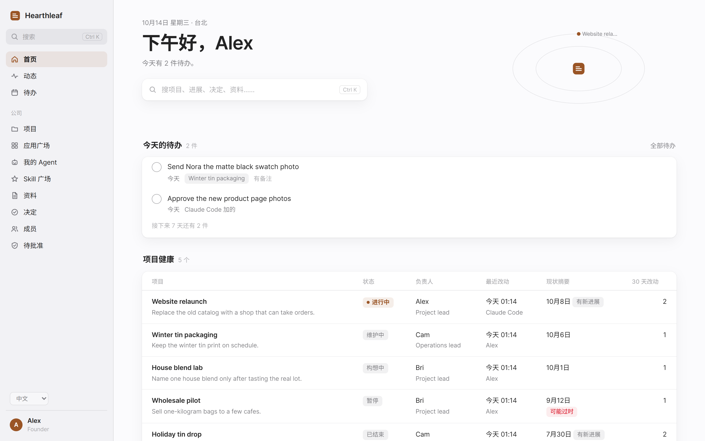
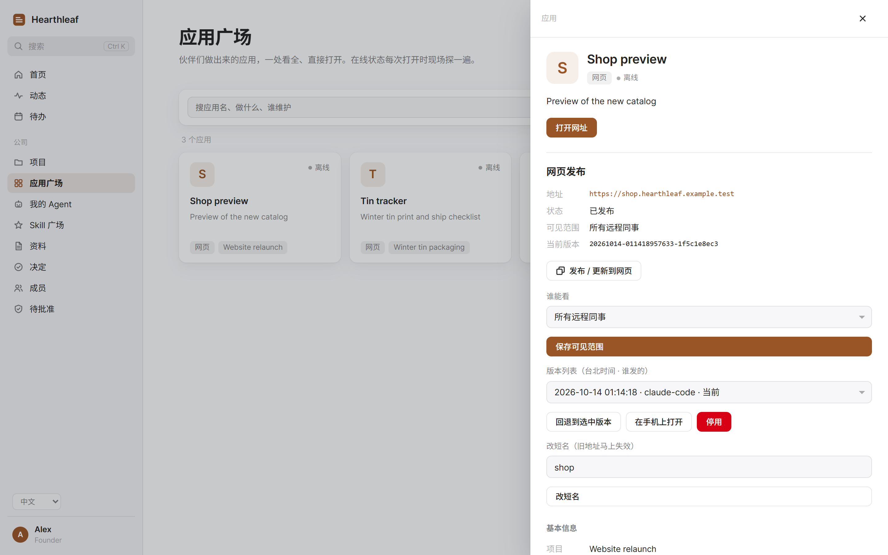
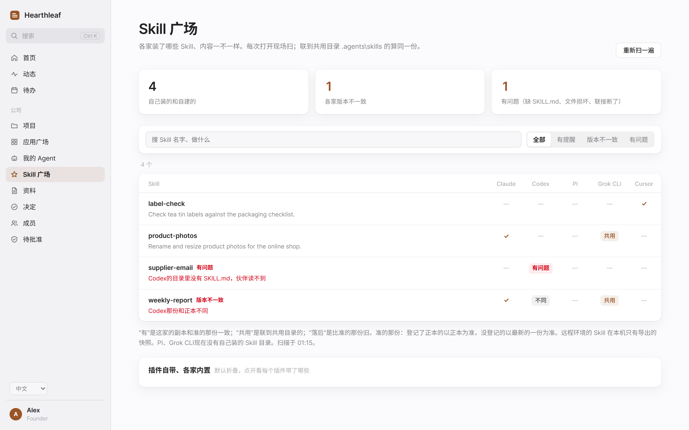

# Onestead

给小公司，也给一人公司的 AI 中台。



## 解决什么问题

每来一个新 agent，都要重新说明公司做什么、有哪些项目、谁负责、已经定了什么。做出来的小应用和实用 Skill，也需要一个方便查找和分配访问权限的地方。

Onestead 把这些公司事实放在你自己的 git 仓库里，让 agent 通过 MCP 读写，让人在网页上查看、批准和管理权限。

## 能做什么

### 公司事实放在一处

手册、项目、决定、资产和成员都用 Markdown 保存。agent 可以读取、搜索、追加进展、更新项目摘要和记录决定。写入会成为以该成员署名的 git 提交。主人在本机网页上查看改动，也能撤回允许撤回的提交。

### 发布小型网页应用

应用广场集中显示应用的说明、维护者和打开方式。发布静态网页时，从广场复制一句发布请求交给本机 agent；agent 上传构建产物，你在网页上选择谁能打开，并批准首次发布。

应用可以使用 `https://demo.example.com` 这样的地址，可见范围分为指定的人、所有远程同事或公开。主人点击**在手机上打开**，就能获得预览链接和二维码。发布前需要配置域名和代理，见[发布网页应用](#发布网页应用)。



### 查找和分享 Skill

Skill 广场扫描本机 agent 已装的 Skill，标出落后的副本、缺失的 `SKILL.md`、损坏文件和断链。可以授权指定成员使用，也可以开放给所有符合接入条件的成员；同事能读说明和下载包。

额外本机 agent 或追加扫描路径用 `skill_harnesses`，额外只读快照目录用 `skill_snapshots` 配置。把 Skill 安装或更新到 agent 中仍是单独的操作，广场提供可复制给 agent 的说明。



### 看待办、首页和待批准事项

每个人都有自己的待办和首页，与本人名下的 agent 共用。待办可以重复。agent 可以提出首页布局草稿，由本人在网页上预览并采用。主人的待批准页集中显示需要处理的事项，例如项目关键角色的接任申请。

界面支持中英双语。`lang` 设置公司默认语言，使用者可以在网页上切换。公司正文保持原来写入的语言。

## 快速开始

需要 **Python 3.12+ 和 Git**。以下步骤从源码仓库目录开始，以已有实际使用验证的 Windows 为例。macOS 和 Linux 的情况见[现在的限制](#现在的限制)。

### 1. 安装

在源码仓库目录运行：

```powershell
python -m pip install .
```

这会在当前 Python 环境中安装 `onestead`、`onestead-mcp`、`onestead-remote` 和 `onestead-backup`。后续步骤继续使用同一个环境。

上面的普通安装 `pip install .` 后，`onestead-backup` 自己找不到源码仓库，只会备份数据仓库，并在备份清单里写明原因。如果要连源码仓库一起备份，请保留源码 git 仓库目录，把 `source_repo`（或环境变量 `ONESTEAD_SOURCE_REPO`）配置为它，或在其中改用 editable 安装：

```powershell
python -m pip install -e .
```

使用 editable 安装期间，不要移动或删除该源码目录。

### 2. 建公司数据仓库

```powershell
onestead init ../company-data --owner alex --name Alex --lang en
```

数据目录应是新目录或空目录。示例把公司仓库放在源码仓库旁边。这条命令会建 git 仓库，写入初始手册和项目，添加主人，完成首个提交，并写入本机配置；还会打印下文各客户端的接入说明。

`alex` 是主人的成员键。`--name Alex` 设置主人的显示名和首个提交的作者。整套工作区的名称由另一个配置键 `name` 设置。

如果已有配置文件，初始化会保留它。继续前请检查它是否指向新仓库，见[常见问题](#常见问题)。

### 3. 打开本机网页

```powershell
python -m onestead.web
```

它会在默认浏览器中打开主人的网页，通常使用 `127.0.0.1:8764`。端口被占用时会另选空闲端口。请使用启动器打开的地址建立会话。

### 4. 接上第一个 agent

在**成员**页添加 agent，使用独立成员键，例如 `codex`，并把**属于谁**设为 `alex`。本机使用时，如果需要读取全部公司事实，选择**全部（本机伙伴）**；是否允许改动，用**能用底座的写接口**设置。

复制 `init` 打印的对应客户端接入块，或使用网页上的接入说明，把身份占位符换成 `codex`。接好后让 agent 调用 `company()`，说明它能看到哪些项目和协作规则。

主人键专供本机网页使用。每个 agent 都需要自己的成员键。

完整步骤见[入门说明](docs/getting-started.md)，示例公司见 [examples/demo-company](examples/demo-company/COLD_START.md)。

## 接各家 agent

本机客户端通过 stdio 启动 `onestead-mcp`，把 `ONESTEAD_AGENT` 设为已登记的 agent 成员键。使用接入说明打印的可执行文件路径，确保客户端启动的是正确的 Python 环境。

| 客户端 | 接法 |
| --- | --- |
| Claude Code | 复制打印的 `claude mcp add` 命令，或把 JSON 块合并到 `.mcp.json`。 |
| Codex | 把打印的 `[mcp_servers.onestead]` 块合并到 `~/.codex/config.toml`。 |
| Cursor | 把打印的 JSON 块合并到 `mcp.json`，通常是 `~/.cursor/mcp.json`。 |
| ChatGPT | 先部署远程服务，再添加自定义 MCP 连接器，地址为 `https://base.example.com/chatgpt/mcp`，认证选 OAuth。授权页使用允许远程接入的 agent 口令。 |

ChatGPT 地址中的域名换成你自己的。人用来登录网页的口令不能授权连接器。详见 [ChatGPT 接入](docs/deploy.md#chatgpt)。

不能使用 MCP 的本机客户端可以调用 CLI，权限相同：

```powershell
onestead company --as codex
```

## 给同事和远程 agent 用

### 对外开放工作区

本机网页是主人的管理入口。同事和远程 agent 使用另一套远程服务：

```powershell
onestead-remote 8765 --public-host base.example.com
```

用 Cloudflare 隧道或 HTTPS 反向代理连接 `127.0.0.1:8765`，保留公网 `Host` 请求头。这台电脑需要保持唤醒并运行服务。配置方式和可选的隧道监督器见[部署说明](docs/deploy.md)。

为相应成员开启远程接入并设置授权，在本机成员页发放口令。人的口令用于登录 `https://base.example.com/`；agent 的口令用于访问 `https://base.example.com/mcp`，请求头为 `Authorization: Bearer <token>`。飞书登录可选，不配置也能用口令登录。

同事可以管理自己名下 agent 的口令。在成员页收回口令，会终止与它关联的访问，包括 ChatGPT OAuth 接入。主人账号继续使用本机网页。

### 发布网页应用

在已有配置中加入：

```toml
public_host = "base.example.com"
site_domain = "example.com"
```

把应用子域名路由到同一个远程服务，配置覆盖这些域名的 DNS 和 TLS。然后在本机广场点击**发布一个网页应用**，把说明交给本机 agent。构建目录根部需要有 `index.html`。首次上传后，等你选定可见范围并发布；后续上传会更新已上线的网站。

你可以调整可见范围、停用网站，或回退到保留的版本。应用会话和工作区会话分开。[静态网页发布说明](docs/sites.md)包含完整流程、通配子域名路由和手机预览。

## 数据和安全

公司事实保存在你的 Markdown git 仓库里。应用构建文件、认证状态和已安装的 Skill 与公司事实分开保存。应用元数据在 git 中，上传的静态文件在本机状态目录中；需要备份上传文件时，应另行备份该目录。

成员有各自的读写授权。agent 的权限受它所属的人约束。个人待办和首页只对本人及本人名下的 agent 可见。管理、关键角色批准和提交撤回由主人在本机网页操作。远程输出会去掉本机路径，并遮蔽能识别的秘密格式。

公司文档、要分享的 Skill 和应用构建里都不要放密钥、密码、token 或 cookie。只记录凭据叫什么、存在哪里，不写原值。写入会拒绝能识别的秘密格式，共享包也会过滤凭据文件；这些检查不能代替对分享内容的检查。登录凭据和会话在数据仓库外管理。

撤回会新增一条反向提交，历史仍保留。后续改动产生冲突时可能无法撤回。详见[数据格式和权限](docs/data-format.md)。

## 不做什么

Onestead 不管理对话记忆，不给 agent 派活，不选择模型，也不运行 agent 工作流。接上你自己的工具和 agent，由你决定它们如何工作。

它不保管业务凭据。网页发布只提供静态文件，不运行应用后端，也不启动本机服务。Skill 的安装和更新交给你自己的工具完成。

## 配置

新安装时，`init` 写入 `~/.onestead/config.toml`。`ONESTEAD_CONFIG` 可以指定其他文件。环境变量优先于文件值。详见 [config.example.toml](config.example.toml) 和[部署配置](docs/deploy.md#configuration)。

| 配置键 | 用途 |
| --- | --- |
| `data_dir` | 公司 git 数据仓库，必填。 |
| `owner_key` | 主人的成员键，必填。 |
| `name` | 工作区显示名，默认 `Onestead`。 |
| `lang` | 公司语言，`en` 或 `zh`，默认 `en`。 |
| `public_host` | 公网工作区域名，远程服务必填。 |
| `site_domain` | 应用子域名的上级域名，不填则关闭发布。 |
| `reserved_slugs` | 额外保留的应用短名。 |
| `state_dir` | 本机运行状态目录。 |
| `backup_dir` | 可选的本机备份根目录，不填则关闭备份；使用不向云端同步的目录。 |
| `source_repo` | 可选，备份时打包的源码 git 仓库（`ONESTEAD_SOURCE_REPO`）；不填则按程序位置往上找，找不到就只备份数据并写明原因。 |
| `skill_harnesses` | 额外本机 agent，或追加到内置 Skill agent 的路径。 |
| `skill_snapshots` | 额外的只读 Skill 快照目录。 |

配置 `backup_dir` 后，`onestead-backup` 打包没有未提交改动的数据仓库和源码仓库。源码仓库优先用 `source_repo`（或 `ONESTEAD_SOURCE_REPO`）；不配时从程序所在目录往上找同时有 `.git` 和 `pyproject.toml` 的目录。快速开始中的普通安装 `pip install .` 找不到，这时只备份数据仓库，`MANIFEST.json` 和 `RESTORE.md` 会写明原因；要备份源码，配置 `source_repo` 或改用 `pip install -e .`。上传的应用文件和认证状态需要另行备份。

## 常见问题

**开始使用需要公网域名吗？** 不需要。本机 MCP、CLI 和主人网页都能独立使用。远程接入需要公网域名和 HTTPS。

**agent 为什么看不到公司内容？** 先登记它的成员，检查读取授权，并把 `ONESTEAD_AGENT` 设为该成员键，不要用主人键。调用 `whoami()` 可以查看身份和权限。

**初始化为什么保留旧配置？** 已有配置默认不覆盖。可以手动修改，使它指向新仓库；也可以初始化时加 `--force-config`，先备份再替换配置。这适用于新目录或空的数据目录，`init` 会拒绝非空目录。

**广场为什么没有发布入口？** 配置 `site_domain`，并使用主人的本机网页。上传工具只通过本机 stdio MCP 提供，远程 MCP 和 OAuth 接口不能上传构建产物。

<a id="已有安装仍然兼容"></a>

**已有安装还能用吗？** 旧命令别名、环境变量和配置位置继续兼容。`ONESTEAD_*` 比旧变量优先，显式空值也一样。已有状态文件留在原处。

## 现在的限制

- Windows 已有实际运行验证。macOS 和 Linux 目前只有模拟测试覆盖，安装和实际运行尚未验证。
- 本机网页启动器需要桌面浏览器会话。macOS 和 Linux 不支持从网页打开本机应用或目录。
- 网页发布仅支持静态构建，没有应用后端或 SPA 路由回退。每个应用保留五个版本；被清除的上传文件无法通过 git 历史恢复。
- 即使正文使用英文，部分数据格式节名和枚举值仍是中文。手动编辑时请遵循[数据格式](docs/data-format.md)。
- 远程接入依赖持续运行的电脑、DNS、TLS 和隧道或代理。

## 协议和参与

Apache-2.0。

欢迎问题报告、文档修正和 pull request。报告问题时附上复现步骤，示例中不要包含私有公司数据或凭据。

[English](README.md)
